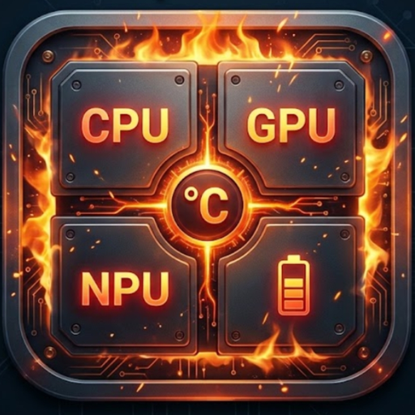

# TempMonitor

Monitor termico de hardware em tempo real para Android com root, escrito em
Kotlin + Jetpack Compose. Feito para o OnePlus 15 (Snapdragon 8 Elite) e o
OnePlus Ace 2 Pro (Snapdragon 8 Gen 2), mas sem nenhum caminho de sensor
hardcoded: o hardware e descoberto dinamicamente em sysfs, entao o mesmo APK
se adapta a qualquer SoC moderno.

## Arquitetura

Clean Architecture + MVVM com fluxo unidirecional (UDF):

    ui/          Compose (tela unica) + ViewModel (intencoes on*, Estado imutavel)
    domain/      Modelos imutaveis, interface ThermalRepository, use cases
    data/        Scanner sysfs, shell root persistente, historico, DataStore
    service/     Foreground Service de coleta em segundo plano
    di/          AppContainer (DI manual, sem Hilt)

Fluxo de dados: SysfsScanner -> ThermalRepositoryImpl (loop de 1 Hz) ->
StateFlow<ThermalState> -> ViewModel -> Compose. A UI nunca fala com o shell.

### Descoberta dinamica de sensores (sem hardcoded)

No primeiro uso (e a cada reescaneamento) um unico script de shell enumera:

- /sys/class/thermal/thermal_zone*/type - classificado por heuristica
  (SensorClassifier): CPU (cpu, cpuss, kryo, oryon, cluster, gold, silver,
  core), GPU (gpu, gpuss, kgsl, g3d, mali), NPU/DSP (npu, cdsp, nsp, tpu,
  hexagon, adsp, "ai" isolado) e bateria (battery, bms, usb, charger...).
- /sys/class/power_supply/*/ *temp* - celula 1/2, conector USB-C, CI de carga.
- Clocks de GPU por glob (kgsl/devfreq), quando o kernel expoe.

O mapeamento e cacheado em DataStore; arquivos de nos brutos podem ser
reatribuidos manualmente na tela "Nos brutos" (o override vence a heuristica
e sobrevive ao rescan). Unico fallback nao-sysfs: BatteryManager oficial.

Zonas que NAO sao termometros ficam de fora da agregacao: limiares de
protecao (cpu-hw-trip-N, cujo temp apenas espelha trip_point_0_temp, ex.: 95 C
constante) e limites de corrente de bateria (*-bcl-lvlN, *-ibat-lvlN, vbat).
Continuam listadas em "Nos brutos" como UNKNOWN, mas nunca entram no hotspot,
na media ou no grafico. Zonas de CPU no formato Qualcomm
cpu-<cluster>-<nucleo>- ganham rotulo unico (ex.: CPU 0.2.1) e sao
agrupadas por "Cluster N".

### Motor de leitura 1 Hz

- Sessao root persistente via libsu: o shell nasce uma vez no processo;
  nenhum processo su novo por ciclo. Sem libsu, cai para um processo su
  interativo proprio com protocolo de marcador.
- Todos os nos sao lidos em UMA invocacao por segundo
  (cat p1; echo SEP; cat p2; ...) em Dispatchers.IO, com periodo compensado
  para manter 1 Hz exato e overhead desprezivel.
- Escalas: zonas termicas = miligraus (padrao do kernel), power_supply/temp
  = decimos, demais arquivos = autodeteccao por magnitude, com filtro de
  plausibilidade (-30 a 150 C).

### Historico adaptativo

- 10 s a 1 min: amostras puras de 1 Hz (buffer circular).
- 5 min a 1 dia: buckets de 1 min com media + pico (preserva hotspot sem
  reter 86.400 amostras/dia/sensor). Toda consulta retorna no maximo
  200 pontos por grafico.
- Faixas longas com tela desligada: ThermalMonitorService (foreground,
  notificacao de baixo impacto atualizada a cada 5 s), ligado pelo switch
  "Historico em segundo plano".

### UI (tela unica)

Hero com o hotspot global do SoC (maior entre CPU/GPU) + media de CPU e
bateria; quatro cards em acordeao (CPU, GPU, NPU, BATERIA) com pico,
sparkline de 30 s e, ao expandir, todos os sensores (CPU agrupada por
cluster), grafico completo e seletor 10s...1d. O detalhe so e composto
quando o card esta expandido: cards colapsados nao recompoem nos invisiveis
a cada tick.

## Pre-requisitos

- Android 8.0+ (minSdk 26); alvo principal: dispositivos com Snapdragon.
- Root com Magisk, KernelSU ou APatch - conceda root ao TempMonitor no
  primeiro uso. Sem root, o app roda em modo limitado (so BatteryManager).
- Para compilar: JDK 17+, Android SDK 35 (platform + build-tools).

## Compilacao (Gradle CLI)

    ./gradlew :app:assembleDebug        # APK debug em app/build/outputs/apk/debug/
    ./gradlew :app:testDebugUnitTest    # testes unitarios (classifier, scaling, historico)
    ./gradlew :app:assembleRelease      # release com minify + assinatura

Crie um local.properties com sdk.dir=/caminho/do/android-sdk (nao versionado).

**Publicar uma versao** (bump de versao, tag, release com APK anexado e checagem
publica) segue o checklist T1-T9 de [UPDATE.md](UPDATE.md); a automacao esta em
`scripts/release.sh` (`--dry-run` valida sem publicar). Sem `keystore.properties`,
a release e assinada com a chave de debug — instalavel, mas nao serve para loja.

## Estrutura

    app/src/main/java/com/tempmonitor/
      MainActivity.kt  TempMonitorApplication.kt
      di/AppContainer.kt
      domain/model/       ThermalNode, ThermalState, TimeRange...
      domain/repository/  ThermalRepository (contrato)
      domain/usecase/     ObserveThermalStateUseCase
      data/scanner/       SysfsScanner, SensorClassifier, TempScaling
      data/shell/         RootShellExecutor (libsu + fallback su persistente)
      data/history/       ThermalHistoryStore (ring buffer + buckets)
      data/local/         SensorMappingStore (DataStore)
      data/battery/       BatteryReader (BatteryManager)
      data/repository/    ThermalRepositoryImpl (loop 1 Hz)
      service/            ThermalMonitorService (foreground)
      ui/                 TempMonitorScreen, TempMonitorViewModel, components/, theme/

## Testes

A logica critica e pura (sem Android) e testada em JVM:
SensorClassifierTest, TempScalingTest, ScanOutputParserTest e
ThermalHistoryStoreTest cobrem classificacao heuristica (incluindo o caso
"available" nao virar NPU), conversao de escala, parsing da descoberta e
downsampling com preservacao de pico.

## Licenca

Uso pessoal/educacional. Sensores termicos variam por kernel: se algum no do
seu aparelho for classificado errado, use a tela "Nos brutos" - e considere
abrir uma issue com a saida dela (id + type dos nos).
